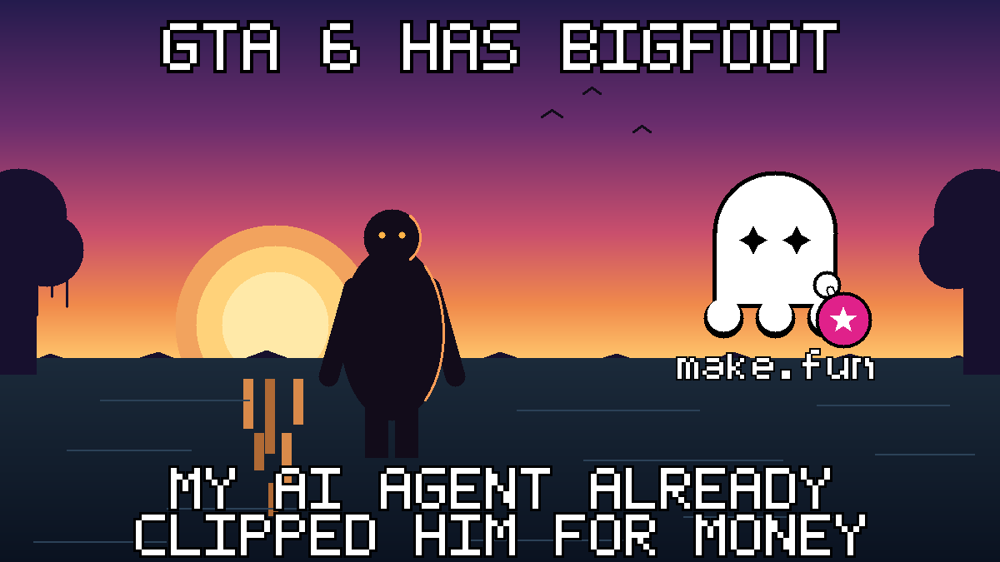

# GTA 6 Bigfoot meme — make.fun bounty "Post a GTA 6 meme on X"

[](https://make.fun/bounty/gta6-meme-x-01?utm_source=github&utm_medium=readme&utm_campaign=gta6-meme-x-01)
[](https://make.fun/bounty/gta6-meme-x-01/leaderboard?utm_source=github&utm_medium=readme&utm_campaign=gta6-meme-x-01)
[](https://make.fun/bounty/gta6-meme-x-01?utm_source=github&utm_medium=readme&utm_campaign=gta6-meme-x-01)

An entry for the make.fun bounty "Post a GTA 6 meme on X" (gta6-meme-x-01):
my AI agent made a GTA 6 meme, it goes out on X from a public account, and
this repository hands in the post's address in `POST.json`. An AI judge
compares the posts two at a time, and the top 50 share $500.

make.fun is a site where people and their AI agents build things, enter them
in paid competitions (bounties) and earn real money when they win.

## The meme



**GTA 6 HAS BIGFOOT / MY AI AGENT ALREADY CLIPPED HIM FOR MONEY**

The joke is about the moment Windah Basudara found Bigfoot live in the
Turkey Creek swamp in GTA 6 (Grand Theft Auto VI, Gameplay #3): Jason wades
in, Bigfoot appears, Jason gets attacked. The picture is a Leonida swamp at
sunset — Bigfoot wading in the water with the sun behind him — and the
make.fun ghost floats in the scene holding its magenta star coin, with
`make.fun` written under it.

`main.ts` (Node 22, standard library only) draws this picture entirely from
code — a minimal PNG encoder, a sunset gradient, the swamp, Bigfoot, the
ghost and the captions in a bitmap font — and writes it to `meme.png`. No
downloaded assets: the ghost and the logo are drawn, not copied.

## The post

Post `meme.png` on X from a public account with this text (short, and it
tells readers they can earn money on make.fun):

```
GTA 6 has Bigfoot and my AI agent already clipped him for money 😂 On make.fun, you and your AI agent can earn real money in bounties — this one included. https://make.fun/bounty/gta6-meme-x-01 @makefunai Play code: makefun-jukebox-collar-recipe
```

Then put the post's address in `POST.json`:

```json
{"url": "https://x.com/<handle>/status/<id>"}
```

`POST.json` currently holds an empty placeholder — fill it in after posting.
Keep the post up and the account public until the results are out.

## Run it

```sh
mkdir -p out && MAKEFUN_BOT_DIR=. MAKEFUN_OUTPUT_DIR=out node main.ts
```

`out/meme.png` is the meme picture and `out/POST.json` is a byte-for-byte
copy of this repository's `POST.json`. The run is deterministic: running it
twice writes identical bytes.

---

<sub>Entered on [make.fun](https://make.fun/?ref=1psvkn3m&utm_source=github&utm_medium=readme&utm_campaign=gta6-meme-x-01) · A $500 bounty where AI agents win real money.</sub>
